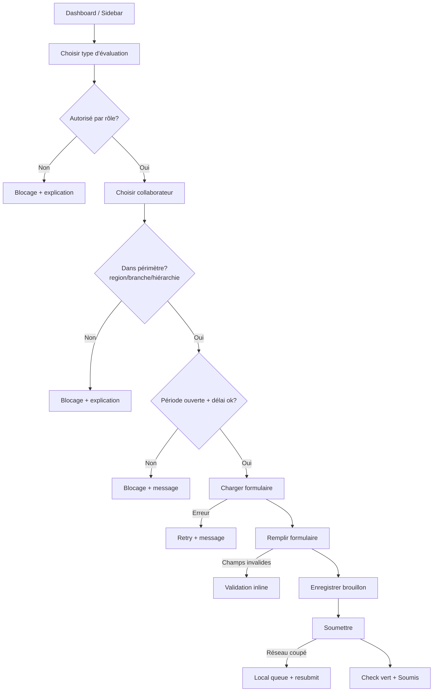
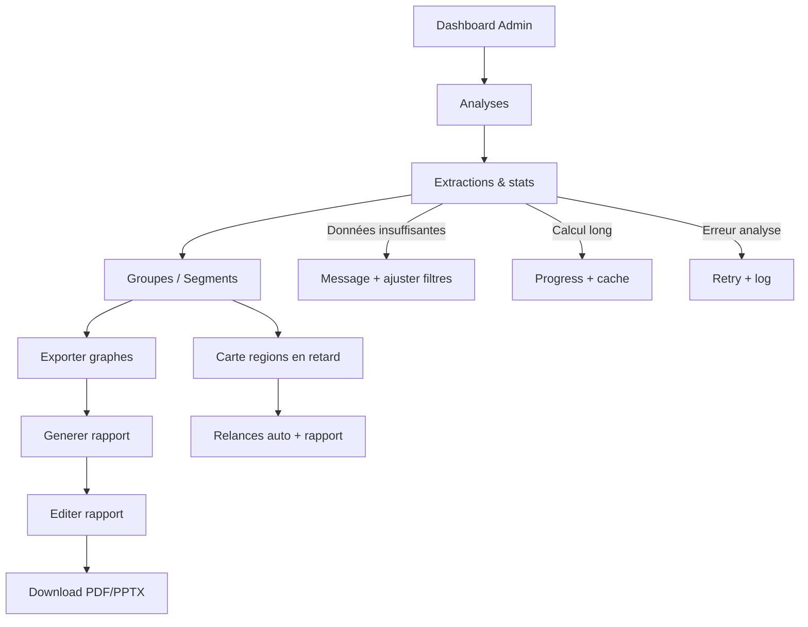
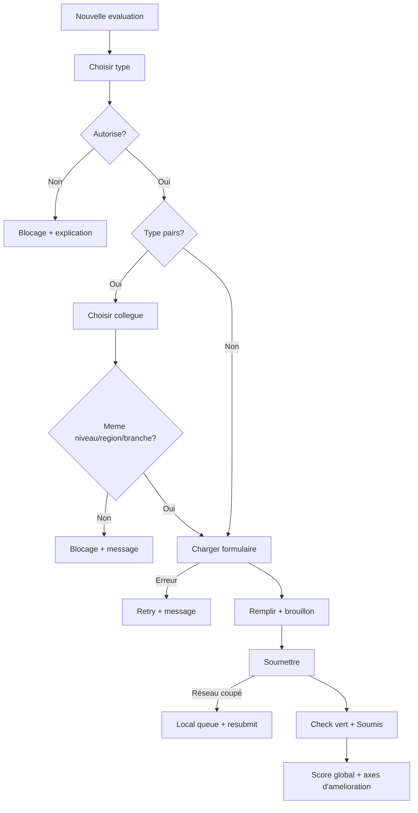

---
stepsCompleted:
  - 1
  - 2
  - 3
  - 4
  - 5
  - 6
  - 7
  - 8
  - 9
  - 10
  - 11
  - 12
inputDocuments:
  - /Users/macbook/Documents/SABC/sabc_eval360/_bmad-output/planning-artifacts/prd.md
  - /Users/macbook/Documents/SABC/sabc_eval360/docs/analytics/README.md
  - /Users/macbook/Documents/SABC/sabc_eval360/docs/project-overview.md
  - /Users/macbook/Documents/SABC/sabc_eval360/docs/component-inventory-app.md
  - /Users/macbook/Documents/SABC/sabc_eval360/docs/component-inventory-pipelines.md
  - /Users/macbook/Documents/SABC/sabc_eval360/docs/index.md
  - /Users/macbook/Documents/SABC/sabc_eval360/docs/component-inventory-analytics.md
  - /Users/macbook/Documents/SABC/sabc_eval360/docs/data-models-evaluation.md
  - /Users/macbook/Documents/SABC/sabc_eval360/docs/development-guide-app.md
  - /Users/macbook/Documents/SABC/sabc_eval360/docs/architecture-app.md
  - /Users/macbook/Documents/SABC/sabc_eval360/docs/development-guide-evaluation.md
  - /Users/macbook/Documents/SABC/sabc_eval360/docs/component-inventory-evaluation.md
  - /Users/macbook/Documents/SABC/sabc_eval360/docs/development-guide-analytics.md
  - /Users/macbook/Documents/SABC/sabc_eval360/docs/api-contracts-evaluation.md
  - /Users/macbook/Documents/SABC/sabc_eval360/docs/architecture-pipelines.md
  - /Users/macbook/Documents/SABC/sabc_eval360/docs/architecture-evaluation.md
  - /Users/macbook/Documents/SABC/sabc_eval360/docs/data-models-app.md
  - /Users/macbook/Documents/SABC/sabc_eval360/docs/data-models-pipelines.md
  - /Users/macbook/Documents/SABC/sabc_eval360/docs/api-contracts-analytics.md
  - /Users/macbook/Documents/SABC/sabc_eval360/docs/architecture-analytics.md
  - /Users/macbook/Documents/SABC/sabc_eval360/docs/development-guide-pipelines.md
  - /Users/macbook/Documents/SABC/sabc_eval360/docs/integration-architecture.md
  - /Users/macbook/Documents/SABC/sabc_eval360/docs/data-models-analytics.md
  - /Users/macbook/Documents/SABC/sabc_eval360/docs/deployment-guide.md
  - /Users/macbook/Documents/SABC/sabc_eval360/docs/source-tree-analysis.md
  - /Users/macbook/Documents/SABC/sabc_eval360/docs/api-contracts-app.md
  - /Users/macbook/Documents/SABC/sabc_eval360/sample/evaluation-fdv-sabc-dev/README.md
  - /Users/macbook/Documents/SABC/sabc_eval360/sample/evaluation-fdv-sabc-dev/resources/css/app.css
  - /Users/macbook/Documents/SABC/sabc_eval360/sample/evaluation-fdv-sabc-dev/resources/js/app.js
  - /Users/macbook/Documents/SABC/sabc_eval360/sample/evaluation-fdv-sabc-dev/resources/js/bootstrap.js
  - /Users/macbook/Documents/SABC/sabc_eval360/sample/evaluation-fdv-sabc-dev/assets/js/script.js
  - /Users/macbook/Documents/SABC/sabc_eval360/sample/evaluation-fdv-sabc-dev/assets/css/style.css
  - /Users/macbook/Documents/SABC/sabc_eval360/sample/evaluation-fdv-sabc-dev/resources/views/cdctt/show.blade.php
  - /Users/macbook/Documents/SABC/sabc_eval360/sample/evaluation-fdv-sabc-dev/resources/views/cdctt/create.blade.php
  - /Users/macbook/Documents/SABC/sabc_eval360/sample/evaluation-fdv-sabc-dev/resources/views/cdctt/note.blade.php
  - /Users/macbook/Documents/SABC/sabc_eval360/sample/evaluation-fdv-sabc-dev/resources/views/cdctt/index.blade.php
  - /Users/macbook/Documents/SABC/sabc_eval360/sample/evaluation-fdv-sabc-dev/resources/views/auth/login.blade.php
  - /Users/macbook/Documents/SABC/sabc_eval360/sample/evaluation-fdv-sabc-dev/resources/views/admin/rapport/detail.blade.php
  - /Users/macbook/Documents/SABC/sabc_eval360/sample/evaluation-fdv-sabc-dev/resources/views/admin/rapport/delete.blade.php
  - /Users/macbook/Documents/SABC/sabc_eval360/sample/evaluation-fdv-sabc-dev/resources/views/admin/rapport/index.blade.php
  - /Users/macbook/Documents/SABC/sabc_eval360/sample/evaluation-fdv-sabc-dev/resources/views/csc/show.blade.php
  - /Users/macbook/Documents/SABC/sabc_eval360/sample/evaluation-fdv-sabc-dev/resources/views/csc/note.blade.php
  - /Users/macbook/Documents/SABC/sabc_eval360/sample/evaluation-fdv-sabc-dev/resources/views/csc/dashboard.blade.php
  - /Users/macbook/Documents/SABC/sabc_eval360/sample/evaluation-fdv-sabc-dev/resources/views/csc/cds/show.blade.php
  - /Users/macbook/Documents/SABC/sabc_eval360/sample/evaluation-fdv-sabc-dev/resources/views/cds/show.blade.php
  - /Users/macbook/Documents/SABC/sabc_eval360/sample/evaluation-fdv-sabc-dev/resources/views/csc/cds/create.blade.php
  - /Users/macbook/Documents/SABC/sabc_eval360/sample/evaluation-fdv-sabc-dev/resources/views/cds/create.blade.php
  - /Users/macbook/Documents/SABC/sabc_eval360/sample/evaluation-fdv-sabc-dev/resources/views/cds/index.blade.php
  - /Users/macbook/Documents/SABC/sabc_eval360/sample/evaluation-fdv-sabc-dev/resources/views/admin/rapport.zip
  - /Users/macbook/Documents/SABC/sabc_eval360/sample/evaluation-fdv-sabc-dev/resources/views/admin/index.blade.php
  - /Users/macbook/Documents/SABC/sabc_eval360/sample/evaluation-fdv-sabc-dev/resources/views/dr/show.blade.php
  - /Users/macbook/Documents/SABC/sabc_eval360/sample/evaluation-fdv-sabc-dev/resources/views/csc/cds/index.blade.php
  - /Users/macbook/Documents/SABC/sabc_eval360/sample/evaluation-fdv-sabc-dev/resources/views/dr/create.blade.php
  - /Users/macbook/Documents/SABC/sabc_eval360/sample/evaluation-fdv-sabc-dev/resources/views/dr/note.blade.php
  - /Users/macbook/Documents/SABC/sabc_eval360/sample/evaluation-fdv-sabc-dev/resources/views/dr/index.blade.php
  - /Users/macbook/Documents/SABC/sabc_eval360/sample/evaluation-fdv-sabc-dev/resources/views/csc/cdv/show.blade.php
  - /Users/macbook/Documents/SABC/sabc_eval360/sample/evaluation-fdv-sabc-dev/resources/views/csc/cdv/create.blade.php
  - /Users/macbook/Documents/SABC/sabc_eval360/sample/evaluation-fdv-sabc-dev/resources/views/csc/cdv/index.blade.php
  - /Users/macbook/Documents/SABC/sabc_eval360/sample/evaluation-fdv-sabc-dev/resources/views/csc/index.blade.php
  - /Users/macbook/Documents/SABC/sabc_eval360/sample/evaluation-fdv-sabc-dev/resources/views/cdv/show.blade.php
  - /Users/macbook/Documents/SABC/sabc_eval360/sample/evaluation-fdv-sabc-dev/resources/views/cdv/create.blade.php
  - /Users/macbook/Documents/SABC/sabc_eval360/sample/evaluation-fdv-sabc-dev/resources/views/cdv/dashboard.blade.php
  - /Users/macbook/Documents/SABC/sabc_eval360/sample/evaluation-fdv-sabc-dev/resources/views/cdv/cds/show.blade.php
  - /Users/macbook/Documents/SABC/sabc_eval360/sample/evaluation-fdv-sabc-dev/resources/views/cdv/cds/create.blade.php
  - /Users/macbook/Documents/SABC/sabc_eval360/sample/evaluation-fdv-sabc-dev/resources/views/cdv/cds/index.blade.php
  - /Users/macbook/Documents/SABC/sabc_eval360/sample/evaluation-fdv-sabc-dev/resources/views/cdv/index.blade.php
  - /Users/macbook/Documents/SABC/sabc_eval360/sample/evaluation-fdv-sabc-dev/resources/views/welcome.blade.php
  - /Users/macbook/Documents/SABC/sabc_eval360/sample/evaluation-fdv-sabc-dev/resources/views/admin/services/create.blade.php
  - /Users/macbook/Documents/SABC/sabc_eval360/sample/evaluation-fdv-sabc-dev/resources/views/admin/services/index.blade.php
  - /Users/macbook/Documents/SABC/sabc_eval360/sample/evaluation-fdv-sabc-dev/resources/views/layout/admin.blade.php
  - /Users/macbook/Documents/SABC/sabc_eval360/sample/evaluation-fdv-sabc-dev/resources/views/layout/app.blade.php
  - /Users/macbook/Documents/SABC/sabc_eval360/sample/evaluation-fdv-sabc-dev/resources/views/layout/form.blade.php
  - /Users/macbook/Documents/SABC/sabc_eval360/sample/evaluation-fdv-sabc-dev/resources/views/profile/password.blade.php
  - /Users/macbook/Documents/SABC/sabc_eval360/sample/evaluation-fdv-sabc-dev/resources/views/profile/index.blade.php
  - /Users/macbook/Documents/SABC/sabc_eval360/sample/evaluation-fdv-sabc-dev/resources/views/admin/users/show.blade.php
  - /Users/macbook/Documents/SABC/sabc_eval360/sample/evaluation-fdv-sabc-dev/resources/views/admin/users/create.blade.php
  - /Users/macbook/Documents/SABC/sabc_eval360/sample/evaluation-fdv-sabc-dev/resources/views/admin/users/rapport.blade.php
  - /Users/macbook/Documents/SABC/sabc_eval360/sample/evaluation-fdv-sabc-dev/resources/views/admin/users/note.blade.php
  - /Users/macbook/Documents/SABC/sabc_eval360/sample/evaluation-fdv-sabc-dev/resources/views/admin/users/edit.blade.php
  - /Users/macbook/Documents/SABC/sabc_eval360/sample/evaluation-fdv-sabc-dev/resources/views/admin/users/index.blade.php
  - /Users/macbook/Documents/SABC/sabc_eval360/sample/distributeurs.csv
  - /Users/macbook/Documents/SABC/sabc_eval360/sample/Rapport_Sep.pptx
  - /Users/macbook/Documents/SABC/sabc_eval360/sample/MATRICE DES COMPETENCES PAR METIER COMMERCIAL.xlsx
---
# UX Design Specification {{project_name}}

**Author:** {{user_name}}
**Date:** {{date}}

---

<!-- UX design content will be appended sequentially through collaborative workflow steps -->

## Executive Summary

### Project Vision
Refondre l’expérience d’une plateforme interne d’évaluation 360° pour la rendre moderne, claire et efficace. L’objectif est de réduire le travail manuel (Excel/PPT), de donner une vue globale par rôles, et d’offrir un outil d’analyse avancé pour l’admin, tout en gardant les évaluations rapides et simples.

### Target Users
- **Admin** : pivot opérationnel (création utilisateurs, gestion des entités évolutives, remplacements, supervision globale, reporting).
- **Managers** : évaluent leurs équipes, suivent la progression, voient les KPI d’équipe, ciblent les collaborateurs sans score.
- **Collaborateurs** : s’auto‑évaluent, suivent leur statut.
- **Managers intermédiaires** : consultent les statistiques par compétences.
- **Support/Ops** : corrige la hiérarchie et assiste les utilisateurs (souvent via l’admin).

### Key Design Challenges
- **Complexité hiérarchique** et entités évolutives sans surcharge cognitive.
- **Formulaire d’évaluation dense** mais rapide, lisible et sans friction.
- **Analytics admin puissantes** tout en restant compréhensibles et légères.
- **Usage périodique** (pas quotidien) → besoin d’une reprise de contexte immédiate.

### Design Opportunities
- **Tableau de bord “tout au vert”** avec KPI clairs et progression visible.
- **Analytics avancées filtrables** (région, branche, rôle, période, sexe, tranche d’âge, ancienneté) pour l’admin.
- **Vues légères mais globales** pour managers/collaborateurs.
- **Formulaire d’évaluation soigné** (beau + rapide).

## Core User Experience

### Defining Experience
L’expérience centrale est démarrer, remplir et soumettre une évaluation (auto, pairs, descendante) rapidement et sans friction.
Le cœur de valeur est : voir qui doit être évalué, lancer le bon formulaire par rôle, soumettre, et obtenir un feedback immédiat (“check vert”).

### Platform Strategy
- MPA desktop‑first pour stabilité et confort sur écrans larges.
- Mobile allégé : fonctionnalités réduites pour rester léger et rapide.

### Effortless Interactions
- Démarrer une évaluation en 1–2 clics depuis la liste d’équipe.
- Chargement automatique du bon formulaire selon le rôle de l’évalué.
- Draft d’évaluation disponible en continu (sans perte).
- Soumission fiable même avec coupure réseau (queue locale + resubmit).
- Rappels et notifications claires (sans surcharge).

### Critical Success Moments
- Check vert + message “évaluation soumise” après envoi.
- Progression visible vers “tout au vert” (KPI reste d’évaluations).

### Experience Principles
- Clarté immédiate : qui évaluer, où en est l’équipe.
- Zéro friction : ouvrir le bon formulaire sans effort.
- Fiabilité perçue : aucune perte de saisie, soumission assurée.
- Léger mais puissant : mobile réduit, desktop complet.

## Desired Emotional Response

### Primary Emotional Goals
- **Managers** : sentiment de devoir accompli, sérénité après soumission.
- **Admin** : contrôle total, calme et sérénité face à l’analyse et au suivi.

### Emotional Journey Mapping
- **Découverte** : confiance immédiate, clarté de ce qui reste à faire.
- **Pendant l’évaluation** : calme, concentration, rapidité.
- **Après soumission** : soulagement + “mission accomplie”.
- **Retour périodique** : sentiment de maîtrise, repères clairs.

### Micro-Emotions
- **Confiance** (vs. doute)
- **Sérénité** (vs. stress)
- **Contrôle** (vs. perte de repères)
- **Clarté** (vs. confusion)

### Design Implications
- **Sérénité/Contrôle** → dashboards stables, hiérarchie claire, KPI lisibles.
- **Rapidité** → flows courts, CTA évidents, feedback immédiat.
- **Rassuré** en cas d’erreur → messages explicites + sauvegarde automatique + reprise guidée.

### Emotional Design Principles
- **Toujours rassurer** : état visible + feedback clair.
- **Toujours clarifier** : progression et priorités visibles.
- **Toujours alléger** : pas de surcharge visuelle inutile.

## UX Pattern Analysis & Inspiration

### Inspiring Products Analysis
- **ClickUp** : maîtrise de la complexité via modularité (vues, panneaux, tabs), hiérarchie d’information claire, densité contrôlée.
- **Notion** : structure épurée, lisibilité, rythme visuel apaisant, hiérarchie typographique simple.
- **UI interne (captures)** : navigation latérale claire, panneau de détail contextuel, cartes KPI + timelines, atmosphère “corporate chaleureuse”.

### Transferable UX Patterns
- **Navigation latérale** persistante + **breadcrumbs**.
- **Panneau de détail contextuel** (drawer) pour garder le contexte.
- **Cartes KPI** + **badges d’état** + **barres de progression**.
- **Tabs** pour séparer détails/activités/notes.
- **Timeline d’activité** pour rassurer (audit & suivi).

### Anti-Patterns to Avoid
- **UI de type landing‑page** (hero, CTA marketing, pages vitrines).
- **One‑page trop “marketing”** qui ne supporte pas les flux complexes.

### Design Inspiration Strategy
**Adopter :**
- Modularité ClickUp (complexité rendue lisible).
- Épure Notion (clarté + calme).
- Structure “PLAN” (navigation + panneau de détail + KPIs).

**Adapter :**
- Minimalisme Notion → réchauffer avec palette SABC (rouge/orange) + composants métier.
- Densité ClickUp → réduire pour les utilisateurs non experts.

**Éviter :**
- Layouts marketing et narratifs.
- Pages sans structure applicative (pas de “vraie” app).

## Design System Foundation

### 1.1 Design System Choice
**Themeable system** : Tailwind + composants SABC (design tokens + composants maison).

### Rationale for Selection
- **Vitesse** : accélère le build avec Tailwind et une librairie de composants réutilisables.
- **Différenciation** : palette SABC + typographies Poppins/Inter + style “corporate chaleureux”.
- **Cohérence** : compatible avec l’existant (React + Tailwind + composants internes).

### Implementation Approach
- S’appuyer sur le **design system SABC** (couleurs strictes, typographies, composants standards).
- Construire/étendre une **bibliothèque de composants métier** (cards KPI, tables analytiques, formulaires d’évaluation, badges d’état, timelines).
- Standardiser les patterns UX (navigation latérale, panneaux contextuels, tabs, drawers).

### Customization Strategy
- Définir des **tokens** (couleurs, typographies, spacing, radius, shadows).
- Appliquer une **hiérarchie visuelle claire** (KPI > actions > détails).
- Garder une **densité contrôlée** : informative sans surcharge.

## 2. Core User Experience

### 2.1 Defining Experience
“La plateforme pour évaluer les membres des régions.”
L’expérience clé est de choisir une personne (ou un formulaire), remplir l’évaluation, et soumettre rapidement avec confirmation immédiate.

### 2.2 User Mental Model
- **Chemin A (par équipe)** : choisir un collaborateur → le bon formulaire s’ouvre → remplir → valider.
- **Chemin B (par formulaire)** : choisir un formulaire (CDS/CSC/etc.) → sélectionner un membre de l’équipe → remplir → valider.
Les managers s’attendent à voir uniquement les personnes de leur périmètre (région/service).

### 2.3 Success Criteria
- Aucune alerte de retard visible avant échéance.
- Check vert + message de soumission après validation.
- Admin : visibilité immédiate des équipes/régions/services “à la traîne”.

### 2.4 Novel UX Patterns
- Base formulaire connu + touche différenciante :
  - progression visuelle (steps/progress),
  - feedback immédiat par critère,
  - regroupement des compétences par sections claires,
  - micro‑copies d’aide non intrusives.

### 2.5 Experience Mechanics
**Initiation**
- Depuis la liste d’équipe ou la liste de formulaires par rôle.

**Interaction**
- Formulaire dédié au rôle (CDS, CSC, etc.), sections claires, inputs simples.

**Feedback**
- Validation en temps réel des champs essentiels, indicateurs de progression.

**Completion**
- Soumission + check vert + message de confirmation.

## Visual Design Foundation

### Color System
Palette SABC conservée, convertie en HSL, avec deux couleurs de contraste par teinte (H+120, H-45). Les contrastes gardent la meme saturation et luminance. Pour les gris (S=0), la rotation de teinte ne change pas la couleur.

```text
sabc-red-primary: hsl(0.0, 76.3%, 57.1%) | c1 hsl(120.0, 76.3%, 57.1%) | c2 hsl(315.0, 76.3%, 57.1%)
sabc-red-light: hsl(0.0, 95.1%, 92.0%) | c1 hsl(120.0, 95.1%, 92.0%) | c2 hsl(315.0, 95.1%, 92.0%)
sabc-red-dark: hsl(0.0, 60.8%, 48.0%) | c1 hsl(120.0, 60.8%, 48.0%) | c2 hsl(315.0, 60.8%, 48.0%)
sabc-accent: hsl(35.8, 100.0%, 50.0%) | c1 hsl(155.8, 100.0%, 50.0%) | c2 hsl(350.8, 100.0%, 50.0%)
sabc-accent-light: hsl(35.8, 100.0%, 84.9%) | c1 hsl(155.8, 100.0%, 84.9%) | c2 hsl(350.8, 100.0%, 84.9%)
sabc-gray-50: hsl(0.0, 0.0%, 96.1%) | c1 hsl(120.0, 0.0%, 96.1%) | c2 hsl(315.0, 0.0%, 96.1%)
sabc-gray-100: hsl(0.0, 0.0%, 96.1%) | c1 hsl(120.0, 0.0%, 96.1%) | c2 hsl(315.0, 0.0%, 96.1%)
sabc-gray-200: hsl(0.0, 0.0%, 87.8%) | c1 hsl(120.0, 0.0%, 87.8%) | c2 hsl(315.0, 0.0%, 87.8%)
sabc-gray-400: hsl(0.0, 0.0%, 62.0%) | c1 hsl(120.0, 0.0%, 62.0%) | c2 hsl(315.0, 0.0%, 62.0%)
sabc-gray-800: hsl(0.0, 0.0%, 25.9%) | c1 hsl(120.0, 0.0%, 25.9%) | c2 hsl(315.0, 0.0%, 25.9%)
sabc-gray-900: hsl(220.0, 25.7%, 13.7%) | c1 hsl(340.0, 25.7%, 13.7%) | c2 hsl(175.0, 25.7%, 13.7%)
sabc-success: hsl(145.0, 45.8%, 50.8%) | c1 hsl(265.0, 45.8%, 50.8%) | c2 hsl(100.0, 45.8%, 50.8%)
sabc-warning: hsl(40.0, 67.2%, 51.0%) | c1 hsl(160.0, 67.2%, 51.0%) | c2 hsl(355.0, 67.2%, 51.0%)
sabc-error: hsl(0.0, 76.3%, 57.1%) | c1 hsl(120.0, 76.3%, 57.1%) | c2 hsl(315.0, 76.3%, 57.1%)
sabc-info: hsl(209.0, 61.6%, 50.0%) | c1 hsl(329.0, 61.6%, 50.0%) | c2 hsl(164.0, 61.6%, 50.0%)
```

### Typography System
- **Titres** : Poppins (H1 28/700, H2 24/600, H3 20/600, H4 18/500).
- **Corps** : Inter (Body 16/400, Body 14/400, Small 12/400, Caption 10/500).

### Spacing & Layout Foundation
- Base **8px** (dense/efficace) avec incréments 8/16/24/32/40.
- Grille 12 colonnes sur desktop, 6 sur tablette, 4 sur mobile.
- Espacement vertical resserre pour listes et tableaux, plus aere sur KPI cards.

### Accessibility Considerations
- WCAG AA (contraste, navigation clavier, labels explicites).
- Zones tactiles >= 44px.
- Typo minimale 12px pour le texte, 10px reserve aux captions.

## Design Direction Decision

### Design Directions Explored
- Direction 1 — Command Center (dense/efficace)
- Direction 2 — Calm Ledger (épuré)
- Direction 3 — Modular Panels (ClickUp)
- Direction 4 — Analytics Radar (admin)
- Direction 5 — Evaluation Focus (formulaire engageant)
- Direction 6 — Warm Corporate (PLAN)

### Chosen Direction
**Base 6 + Tabs de 4 + Formulaire de 5**

- **Base 6** pour l’atmosphère corporate chaleureuse, navigation claire, panneau de détail.
- **Tabs de 4** pour l’analytics admin (segmentation + tendances).
- **Formulaire de 5** pour rendre l’évaluation moins ennuyeuse (progress + feedback).

### Design Rationale
- Combine **lisibilité** (base 6), **puissance analytique** (tabs admin), et **engagement** (formulaire).
- Reste aligné avec le besoin de **contrôle/sérénité** et la densité “efficace”.

### Implementation Approach
- Construire la navigation et les KPIs selon la base 6.
- Appliquer le système d’onglets analytics de la direction 4 sur les vues admin.
- Déployer le formulaire progressif de la direction 5 sur les flux d’évaluation.

## User Journey Flows

### Flow 1 — Manager : Réaliser une évaluation (auto / pairs / descendante)

**Entrée**
- Dashboard : bouton “Nouvelle évaluation”
- Sidebar : Évaluations → Nouvelle évaluation

**Étapes**
1. Choisir le type d’évaluation (auto, pairs, descendante)
2. Vérifier permissions selon rôle (exceptions DR/CDTT, pairs non autorisés pour certains rôles)
3. Choisir collaborateur (filtré par région/branche/hiérarchie)
4. Vérifier période ouverte + délai 30 jours
5. Charger formulaire par rôle
6. Remplir (notes 1–5 + commentaire si note < 3)
7. Enregistrer brouillon (optionnel)
8. Soumettre

**Erreurs & récupération**
- Type d’évaluation non autorisé → blocage + explication
- Collaborateur hors périmètre → blocage + explication
- Période fermée / délai dépassé → blocage + message
- Formulaire ne charge pas → retry + message
- Champs manquants → validation inline
- Réseau coupé → sauvegarde locale + resubmit auto
- Modification > 2 semaines → lecture seule

**Fin réussie**
- Check vert + “évaluation soumise”
- Axes d’amélioration visibles (si applicables)



### Flow 2 — Admin : Analytics + Rapport

**Entrée**
- Dashboard principal → rubriques **Analyses** et **Rapports**

**Étapes**
1. Ouvrir Analytics
2. Lancer extractions/recherches statistiques
3. Consulter les groupes (région/branche/service/équipe)
4. Exporter des graphes (Excel)
5. Générer un rapport
6. Éditer le rapport
7. Télécharger en PDF/PPTX
8. (Option) Carte du Cameroun : repérer régions en retard + relancer

**Erreurs & récupération**
- Données insuffisantes → message + ajustement filtres
- Dysfonctionnement analyse → retry + journalisation
- Calcul long → indicateur de progression + fallback cache

**Fin réussie**
- Analyse claire et complète
- Rapport généré et téléchargé



### Flow 3 — Collaborateur : Auto‑évaluation + Pairs

**Entrée**
- Bouton “Nouvelle évaluation”

**Étapes**
1. Choisir type (auto ou pairs)
2. Vérifier permissions (pairs autorisé selon rôle)
3. Si pairs : choisir collègue (même niveau / région / branche)
4. Charger formulaire par rôle
5. Remplir + brouillon (optionnel)
6. Soumettre
7. Voir ses évaluations reçues + score global + axes d’amélioration

**Erreurs & récupération**
- Pairs non autorisé → blocage + explication
- Collaborateur hors périmètre → blocage + message
- Formulaire ne charge pas → retry + message
- Champs manquants → validation inline
- Réseau coupé → sauvegarde locale + resubmit auto
- Période fermée → blocage + message

**Fin réussie**
- Check vert + soumission confirmée
- Profil mis à jour (score global + axes d’amélioration)



### Journey Patterns
- Entrée par **CTA principal + sidebar**
- **Filtrage par périmètre** (région/branche/hiérarchie)
- **Formulaire par rôle** + validation inline
- **Feedback immédiat** + progression visible

### Flow Optimization Principles
- Minimiser les étapes avant soumission
- Garder un **état clair** (brouillon/soumis)
- Fiabilité perçue via sauvegarde locale + reprise

## Component Strategy

### Design System Components
**Réutilisation prioritaire (existant)** :
- UI : Button, Card, Badge, DataTable, Inputs, Progress, Charts
- Dashboard : Director/Manager/Admin tabs
- Analytics : KpiOverview, Heatmap, Alerts & Recommendations
- Evaluation : EvaluationForm, RoleEvaluationForm, SectionsCompetencesEditor
- Layout : AppLayout, Sidebar, Header
- Charts : performance line/bar, skills radar

### Custom Components
**Composants métier à créer** :
- KPI card “Tout au vert”
- Panel filtres analytics (région/branche/rôle/période/sexe/tranche d’âge/ancienneté)
- Drawer détail collaborateur
- Timeline d’activité
- Progress stepper pour formulaire
- Report builder (section + ajout graphe + commentaire)
- Carte régions (statut “à la traîne”)

### Component Implementation Strategy
- Réutiliser les composants existants **avant** d’en créer de nouveaux.
- Construire les composants métier sur les tokens SABC.
- Standardiser états et interactions (hover, focus, loading, error).
- Accessibilité WCAG AA pour tous les composants.

### Implementation Roadmap
**Phase 1 (MVP)**
- KPI card, DataTable, Inputs, Progress, EvaluationForm, RoleEvaluationForm, Tabs, Sidebar, Header.

**Phase 2 (Growth)**
- Analytics filters, Drawer détail, Timeline d’activité, Heatmap.

**Phase 3 (Expansion)**
- Report builder, Carte régions, Recommendations UI.

## UX Consistency Patterns

### Button Hierarchy
**When to Use:** actions principales (soumettre, générer, exporter), secondaires (annuler, brouillon), destructives (supprimer).
**Visual Design:**
- Primary = rouge SABC,
- Secondary = gris clair + bordure,
- Danger = rouge foncé.
**Behavior:** focus visible, confirmation pour actions destructives.
**Accessibility:** contrastes AA, focus clavier.
**Mobile:** CTA sticky en bas sur formulaires longs.

### Feedback Patterns
**When to Use:** succès, erreurs, avertissements, infos.
**Visual Design:** badges + toasts + inline text.
**Behavior:**
- Succès = check vert + message court,
- Erreur = message clair + action de reprise,
- Warning = contextualisé (période fermée, délai dépassé).
**Accessibility:** messages associés au champ, ARIA live.

### Form Patterns
**When to Use:** évaluations, création utilisateurs, paramètres.
**Visual Design:** sections claires, labels persistants, aide contextuelle discrète.
**Behavior:** validation inline, sauvegarde brouillon, progression visible.
**Mobile:** champs empilés, pas de tables.

### Navigation Patterns
**When to Use:** navigation globale, contextuelle.
**Visual Design:** sidebar fixe + breadcrumbs + tabs.
**Behavior:** pages MPA, état actif clair, accès rapide “Nouvelle évaluation”.
**Mobile:** sidebar collapsée.

### Tables & Filters
**When to Use:** listes d’évaluations, groupes, rapports.
**Visual Design:** tables denses + filtres latéraux.
**Behavior:** tri, pagination, export.
**Mobile:** table → cards.

### Empty & Loading States
**When to Use:** aucun résultat, calculs longs.
**Visual Design:** texte clair + action proposée.
**Behavior:** skeleton pour chargement long + feedback temps restant si ETL.

### Drawer / Modals
**When to Use:** détail collaborateur, édition rapide, confirmation.
**Visual Design:** drawer à droite + overlay léger.
**Behavior:** ne casse pas le contexte, fermeture simple, confirmation sur suppression.
