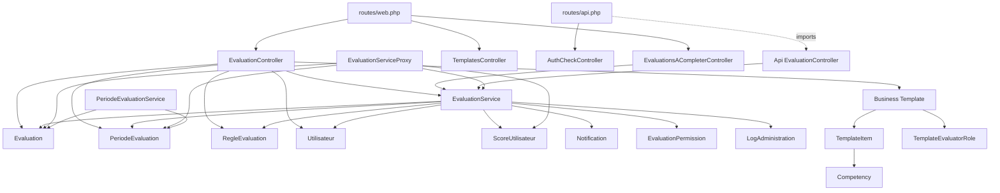

# Deep-Dive API/Back-end Bloc 2 - Flux Evaluation

**Generated:** 2026-02-13
**Scope:** Flux Evaluation end-to-end (routes, controllers web/api, services, modèles, proxy microservice)
**Files Analyzed:** 23
**Lines of Code:** 4705
**Workflow Mode:** Exhaustive Deep-Dive

## Overview

Ce bloc documente le flux Evaluation complet du monolithe Laravel et son pont de migration vers le microservice Go (strangler pattern). Le comportement réel en production est hybride: UI web Inertia + règles métier locales dans `EvaluationService` + possibilité de délégation vers `EvaluationServiceProxy` selon feature flags.

**Purpose:** Fournir une cartographie actionnable pour modifier le flux d'évaluation sans régression fonctionnelle.

**Key Responsibilities:**
- Exposition des routes d'évaluation côté web (`common/evaluations/*`) et endpoints API auth
- Validation métier (permissions, période active, statut d'évaluation)
- Persistance multi-bases (mysql + pgsql)
- Notifications, logs administratifs, calcul de scores
- Migration progressive vers microservice evaluation (`services.evaluation.enabled`)

**Integration Summary:**
- Front: Inertia pages + appels JSON de détails/templates
- Data: tables `evaluations`, `periodes_evaluation`, `regles_evaluation`, `scores_utilisateurs`, `notifications_utilisateurs`
- Infra: Sanctum/auth web, cache/metrics, OpenTracing headers pour appels inter-services

## API and Route Surface

### Routes effectivement câblées (evaluation)
- `GET /common/evaluations` -> `EvaluationController@index`
- `GET /common/evaluations/mine` -> `EvaluationController@mine`
- `GET /common/evaluations/pending` -> `EvaluationsACompleterController@index`
- `GET /common/evaluations/create` -> `EvaluationController@create`
- `GET /common/evaluations/details` -> `EvaluationController@details` (JSON)
- `GET /common/evaluations/{id}` -> `EvaluationController@show`
- `GET /common/evaluations/{id}/edit` -> `EvaluationController@edit`
- `PUT /common/evaluations/{id}` -> `EvaluationController@update`
- `POST /common/evaluations` -> `EvaluationController@store`
- `GET /evaluations/templates/applicables` -> `TemplatesController@applicables` (JSON)

### Routes API Laravel
- `GET /api/user` (auth:sanctum)
- `GET /api/auth/check` (auth:sanctum)

Note importante: `app/Http/Controllers/Api/EvaluationController.php` est implémenté mais non branché explicitement dans `routes/api.php`.

## Complete File Inventory

### `routes/web.php` (341 LOC)
- **Purpose:** point d'entrée principal des flows Inertia; expose le bloc `common/evaluations`.
- **Key details:** toute la zone evaluations est sous middleware `auth`; admin/evaluation est isolé sous `role:ADMIN`.
- **Side effects:** routage vers controllers mutateurs (`store/update`).
- **Risks:** cohabitation de routes historiques admin + nouvelles routes peut créer de la confusion de surface API.
- **Verification steps:** `php artisan route:list | rg evaluations`.

### `routes/api.php` (49 LOC)
- **Purpose:** surface API sanctum minimale.
- **Key details:** controllers evaluation/hierarchy importés mais non exposés.
- **Risks:** dérive entre code implémenté et code réellement accessible.

### `app/Http/Controllers/EvaluationController.php` (449 LOC)
- **Purpose:** orchestration web (Inertia + JSON) du cycle création/édition/soumission.
- **Exports:** `store`, `index`, `mine`, `pending`, `create`, `details`, `show`, `edit`, `update`.
- **Dependencies:** `EvaluationService`, modèles `Evaluation/PeriodeEvaluation/Utilisateur/RegleEvaluation`, trait `FormatsUserData`, DB pgsql direct.
- **Key details:**
- `store` enregistre un brouillon dans PGSQL (`evaluations`) avec UUID.
- `details` résout template/règle soit via mapping statique UUID, soit via tables business templates.
- `update` mutabilise uniquement les brouillons de l'évaluateur courant, avec option `submit`.
- **Side effects:** insert/update PGSQL, transitions de statut, redirections UI.
- **Error handling:** `abort(401/403/404/422)` + validation request.
- **Contributor note:** plusieurs conventions d'identifiants coexistent (matricule string vs anciens ids).

### `app/Http/Controllers/EvaluationsACompleterController.php` (77 LOC)
- **Purpose:** liste des évaluations à compléter par type (`auto/pairs/descendante/ascendante`).
- **Dependencies:** `EvaluationService`, `EvaluationPermission`, trait `FormatsUserData`.
- **Side effects:** lecture uniquement.
- **Risks:** dépend fortement de la cohérence du moteur permissions.

### `app/Http/Controllers/Api/EvaluationController.php` (354 LOC)
- **Purpose:** façade API REST complète pour évaluation (latent/non routé explicitement).
- **Key details:** endpoints `store/update/submit/validate/rapport/historique` déjà prêts.
- **Risks:** comportement non testé en prod si routes absentes.

### `app/Http/Controllers/TemplatesController.php` (49 LOC)
- **Purpose:** expose les templates applicables au rôle évaluateur.
- **Key details:** fallback silencieux vers liste vide si schéma absent/incomplet.
- **Side effects:** lecture PGSQL uniquement.

### `app/Services/EvaluationService.php` (692 LOC)
- **Purpose:** coeur métier des évaluations.
- **Exports majeurs:**
- `canCreateEvaluation`
- `creerEvaluation`
- `mettreAJourNotes`
- `soumettrePourValidation`
- `validerEvaluation`
- `mettreAJourScores`
- `genererRapportPeriode`
- `envoyerRappelsEvaluations`
- `getEvaluationsACompleter`
- **Dependencies:** `Evaluation`, `Utilisateur`, `PeriodeEvaluation`, `RegleEvaluation`, `ScoreUtilisateur`, `Notification`, `LogAdministration`, `EvaluationPermission`.
- **Side effects:**
- création/mise à jour évaluation
- émission notifications
- écritures audit log
- update/insert scores
- **Risks:** complexité métier élevée + mix mysql/pgsql + conventions d'id mixtes.

### `app/Services/EvaluationServiceProxy.php` (487 LOC)
- **Purpose:** strangler proxy vers microservice Go evaluation.
- **Key details:** feature flags granularisés (`create_evaluation`, `submit_evaluation`, etc.), fallback legacy systématique en cas d'échec réseau.
- **Side effects:** appels HTTP inter-service avec headers de traçage + user context.
- **Risks:** divergence de payload entre proxy et legacy; confusion `id`/`matricule` dans fallback.

### `app/Services/PeriodeEvaluationService.php` (259 LOC)
- **Purpose:** gouvernance des périodes (chevauchement, ouverture/fermeture, stats).
- **Side effects:** écritures période + calcul stats via lecture `evaluations`.

### `app/Providers/EvaluationServiceProvider.php` (55 LOC)
- **Purpose:** enregistre le singleton `EvaluationServiceProxy`.
- **Risks:** provider inactif si non déclaré dans bootstrap/config providers.

### `app/Traits/FormatsUserData.php` (197 LOC)
- **Purpose:** normalisation affichage user/roles/permissions côté UI.
- **Side effects:** aucun (lecture/transformation).

### `app/Models/Evaluation.php` (259 LOC)
- **Purpose:** entité évaluation (pgsql) + règles de soumission/validation.
- **Key details:** `peutEtreSoumise`, `peutEtreValidee`, `getNoteMoyenne`.

### `app/Models/PeriodeEvaluation.php` (330 LOC)
- **Purpose:** cycle de vie des périodes.
- **Key details:** scopes `active/ouverte/fermee`, helpers `ouvrir/fermer`.

### `app/Models/Utilisateur.php` (497 LOC)
- **Purpose:** identifiant auth matricule + logique hiérarchique d'évaluation/remplacement.
- **Risks:** modèle très chargé (policy + accès data + auth).

### `app/Models/RegleEvaluation.php` (149 LOC)
- **Purpose:** règles/critères d'évaluation et fenêtre active.

### `app/Models/ScoreUtilisateur.php` (221 LOC)
- **Purpose:** agrégats de score par période avec clé composite `matricule + id_periode`.

### `app/Models/Notification.php` (268 LOC)
- **Purpose:** notifications utilisateur + helpers métier évaluation.
- **Key details:** fallback in-memory en cas d'échec persistance (ne casse pas le flow).

### `app/Models/EvaluationPermission.php` (122 LOC)
- **Purpose:** matrice permissions rôle->rôle->type_evaluation.

### `app/Models/LogAdministration.php` (189 LOC)
- **Purpose:** journal d'audit des actions sensibles.

### `app/Models/Business/Template.php` (37 LOC)
### `app/Models/Business/TemplateItem.php` (33 LOC)
### `app/Models/Business/TemplateEvaluatorRole.php` (26 LOC)
### `app/Models/Business/Competency.php` (21 LOC)
- **Purpose:** modèle du catalogue templates/compétences utilisé par `details` et `applicables`.
- **Risks:** dépendance à schéma PGSQL business; comportements fallback si tables manquantes.

## Dependency Graph

### Entry Points (not imported inside scope)
- `routes/web.php`
- `routes/api.php`

### Leaf Nodes (scope)
- `app/Models/Business/Competency.php`
- `app/Providers/EvaluationServiceProvider.php`

### Circular Dependencies
- Aucun cycle explicite dur dans le scope analysé.

## Data Flow Analysis

### 1) Création d'une évaluation (web)
1. UI Inertia appelle `POST /common/evaluations`
2. `EvaluationController@store` valide payload (`target_matricule`, `notes`, `id_regle?`)
3. Appel `EvaluationService::canCreateEvaluation`
4. Vérifications permissions + période active + doublon
5. Insertion PGSQL `evaluations` (statut `brouillon`)
6. Redirection UI avec message succès

### 2) Edition/soumission
1. UI appelle `PUT /common/evaluations/{id}` avec `submit=true|false`
2. Contrôle ownership + statut brouillon
3. Update `notations_json`, `note_globale`, `commentaire_general`
4. Si `submit=true` -> statut `soumis`, date soumission
5. Redirection vers page show/edit

### 3) Validation managériale (service/API)
1. Appel service `validerEvaluation`
2. Contrôle autorisation hiérarchique
3. Statut `valide` ou rejet (retour brouillon)
4. Ecriture log admin
5. Notification évaluateur
6. Recalcul score utilisateur si validé

### 4) Templates applicables
1. `GET /evaluations/templates/applicables`
2. Contrôle rôle utilisateur
3. Jointure PGSQL templates + rôles évaluateurs
4. Retour JSON des templates publiés applicables

## Integration Points

### APIs consumed
- Microservice evaluation Go (via proxy)
- `POST /api/v2/evaluations`
- `GET /api/v2/evaluations/{id}`
- `PUT /api/v2/evaluations/{id}`
- `POST /api/v2/evaluations/{id}/submit`
- `POST /api/v2/evaluations/{id}/validate`
- `GET /api/v2/periodes`
- `GET /api/v2/scores/{matricule}`
- Auth inter-service: `X-Service-Key` + propagation user/trace headers

### APIs exposed
- Web routes `common/evaluations/*`
- JSON helper routes `evaluations/templates/applicables`, `common/evaluations/details`
- API sanctum `GET /api/user`, `GET /api/auth/check`

### Database access
- PGSQL: `evaluations`, `periodes_evaluation`, `regles_evaluation`, tables templates business
- MySQL: `utilisateurs`, `scores_utilisateurs`, `notifications_utilisateurs`, `logs_administration`

### Shared state/events
- Session/auth web + sanctum
- Notifications métier comme mécanisme d'événements utilisateur
- Cache utilisé pour périodes actives côté proxy

## Related Code References

- `app/Http/Controllers/PeriodeEvaluationController.php`: gestion admin des périodes, utile pour comprendre transitions de statut.
- `app/Console/Commands/OuvrirPeriodesAutomatiquement.php`: automatisation d'ouverture de période.
- `app/Console/Commands/FermerPeriodesAutomatiquement.php`: automatisation de fermeture/calcul final.
- `app/Policies/EvaluationPolicy.php`: règles d'accès complémentaires (si activées dans certaines routes).
- `app/Services/TemplateAssignationService.php`: logique d'affectation templates/périodes.

## Reuse Opportunities

- Réutiliser `EvaluationService::canCreateEvaluation` partout (éviter duplications controller/policy).
- Standardiser le calcul de note globale (actuellement partiellement dupliqué dans controller/service).
- Centraliser les transitions de statut (`brouillon/soumis/valide/rejete`) dans une couche unique.
- Utiliser `FormatsUserData` de manière homogène dans tous les contrôleurs evaluation/admin.

## Contributor Checklist

- **Risks & gotchas:**
- Conventions d'identifiants mixtes (`matricule` string vs ancien `id_utilisateur`) dans plusieurs branches.
- `Api/EvaluationController` est riche mais non exposé explicitement via `routes/api.php`.
- Proxy microservice peut masquer des divergences de contrat via fallback legacy.
- **Pre-change verification steps:**
- `php artisan route:list | rg 'evaluations|auth/check|templates/applicables'`
- Vérifier période active en base PGSQL (`periodes_evaluation`)
- Tester create/update/submit avec un utilisateur non-admin
- Vérifier notifications + scores après validation
- **Suggested tests before PR:**
- Feature tests HTTP pour `common/evaluations` (403 admin, 422 sans période active)
- Tests de service sur transitions statut et permissions
- Test proxy: feature flag on/off + fallback legacy
- Test contrat JSON `details` et `templates/applicables`

## Modification Guidance

### Pour ajouter une nouvelle fonctionnalité
- Ajouter d'abord la règle métier dans `EvaluationService`.
- Exposer ensuite via controller web/api selon besoin.
- Si microservice concerné, ajouter flag et fallback dans `EvaluationServiceProxy`.

### Pour modifier une fonctionnalité existante
- Identifier le point source (controller vs service vs proxy).
- Ne pas changer le schéma de payload JSON sans mettre à jour frontend Inertia.
- Conserver compatibilité matricule/id legacy.

### Pour retirer/déprécier
- Débrancher routes d'abord.
- Conserver fallback legacy temporaire si proxy encore actif.
- Documenter migration de données/statuts.

### Testing checklist for changes
- [ ] Flux create/update/submit complet validé
- [ ] Droits d'accès par rôle revalidés (ADMIN/DR/CDTT/etc.)
- [ ] Notifications créées ou fallback correctement logué
- [ ] Scores recalculés après validation
- [ ] Routes et payloads inchangés ou versionnés

---
_Generated by document-project workflow (deep-dive progressive mode)_
_Base Documentation: docs/index.md_
_Scan Date: 2026-02-13_
_Analysis Mode: Exhaustive_
