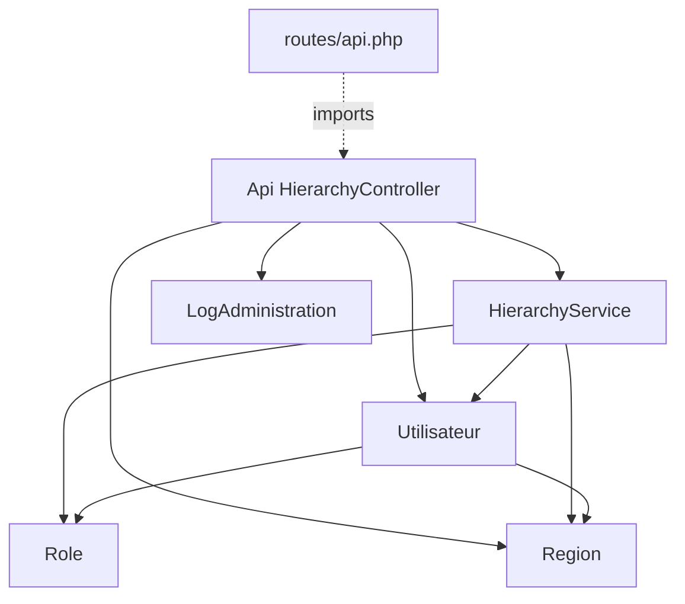

# Deep-Dive API/Back-end Bloc 3 - Flux Hierarchy

**Generated:** 2026-02-13
**Scope:** Hierarchy API/service et socle hiérarchique (routes API, controller, service, modèles clés)
**Files Analyzed:** 7
**Lines of Code:** 1688
**Workflow Mode:** Exhaustive Deep-Dive

## Overview

Ce bloc couvre la logique hiérarchique (lecture de chaîne de commandement, supervision, assignation de manager, stats région) telle qu’implémentée dans l’API Laravel et le service métier associé. Le contrôle d’accès est fortement orienté rôles DR/CDTT et relation de région/branche.

**Purpose:** sécuriser et rendre modifiable le module hiérarchique sans casser les règles SABC.

**Key Responsibilities:**
- Exposer les endpoints de hiérarchie (quand routés)
- Appliquer les règles d’accès hiérarchiques (self/supervision/DR-CDTT)
- Valider les assignations manager (niveaux, branche, cycle)
- Fournir la structure hiérarchique par région

**Integration Summary:**
- Auth: dépend de l’utilisateur connecté (`Auth::user()`)
- Data: `utilisateurs`, `roles`, `regions`, logs admin
- Couplage: utilisé indirectement par flux évaluation (`getUtilisateursEligiblesPourEvaluation`)

## API Surface and Exposure Status

### Routes API réelles
- `routes/api.php` n’expose actuellement que:
- `GET /api/user`
- `GET /api/auth/check`

### Exposition Hierarchy
- `HierarchyController` est importé dans `routes/api.php` mais **aucune route active** ne pointe vers ses méthodes.
- Conséquence: la logique hiérarchique API est implémentée mais latent/non accessible publiquement via cette table de routage.

## Complete File Inventory

### `routes/api.php` (49 LOC)
- **Purpose:** registre API sanctum minimal.
- **Exports:** groupe `auth:sanctum` + 2 routes actives.
- **Dependencies:** `AuthCheckController`, imports `EvaluationController`, `HierarchyController` non câblés.
- **Used by:** route service provider Laravel.
- **Side effects:** aucun direct.
- **Risks:** dérive entre code controller disponible et surface API réelle.
- **Verification steps:** `php artisan route:list --path=api`.

### `app/Http/Controllers/Api/HierarchyController.php` (416 LOC)
- **Purpose:** façade API pour hiérarchie/supervision/assignation manager/stats.
- **Exports:**
- `getHierarchieRegion`
- `getSubordonnesDirects`
- `getTousSubordonnes`
- `getChaineHierarchique`
- `verifierSupervision`
- `validerAssignationManager`
- `assignerManager`
- `getManagersEligibles`
- `getStatistiquesRegion`
- helpers privés: `peutAccederRegion`, `peutVoirSubordonnes`, `peutVoirChaineHierarchique`
- **Dependencies:** `HierarchyService`, `Utilisateur`, `Region`, `Auth`, `LogAdministration`.
- **Key implementation details:**
- Gate d’accès sur région/utilisateur avant chaque lecture sensible.
- Restriction DR/CDTT pour validation/assignation manager.
- Double validation assignation: service + écriture + audit log.
- **State management:** stateless au niveau controller.
- **Side effects:** update manager (`utilisateurs`), insertion log audit.
- **Error handling:** JSON structuré avec 403/404/400.
- **Risks:** conventions mixtes `id_utilisateur` vs `matricule` selon modèles/tables.

### `app/Services/HierarchyService.php` (303 LOC)
- **Purpose:** logique métier hiérarchique centrale.
- **Exports:**
- `getHierarchieRegion`
- `getSubordonnesDirects`
- `getTousSubordonnes`
- `getChaineHierarchique`
- `peutSuperviser`
- `getUtilisateursEligiblesPourEvaluation`
- `validerAssignationManager`
- helpers privés `construireStructureHierarchique`, `organiserUtilisateursParNiveau`, `detecterCycleHierarchique`
- **Dependencies:** `Utilisateur`, `Region`, `Role`, collections Laravel.
- **Key implementation details:**
- Structure variable selon `est_taniere`.
- Validation supervision via niveau hiérarchique + contraintes de branche.
- Détection cycle via remontée de chaîne manager.
- **Side effects:** lecture majoritaire; pas d’écriture directe.
- **Risks:** récursivité potentiellement coûteuse sur org charts volumineux.

### `app/Models/Utilisateur.php` (497 LOC)
- **Purpose:** modèle utilisateur + règles métier (évaluation, remplacements, hiérarchie).
- **Exports critiques pour hierarchy:**
- relations `manager`, `subordonnes`, `regionEntity`, `roleModel`
- accessor `getIdUtilisateurAttribute` (compat ancien schéma)
- logique `peutEvaluer`, indisponibilité/remplacement
- **Dependencies:** `Role`, `Region`, relations multiples.
- **Key implementation details:**
- clé primaire auth = `matricule` (string)
- compatibilité legacy via attribut calculé `id_utilisateur`
- **Risks:** modèle “god object” avec règles métier dispersées.

### `app/Models/Role.php` (148 LOC)
- **Purpose:** matrice de capacités et niveau hiérarchique.
- **Exports:** `getNiveauHierarchique`, `peutEvaluer`.
- **Key details:** règles spécifiques RTM/SRMO, logique cross-branch.

### `app/Models/Region.php` (86 LOC)
- **Purpose:** entité région + typologie tanière/non-tanière.
- **Exports:** relation `utilisateurs`, accessor `getTypeRegionAttribute`.

### `app/Models/LogAdministration.php` (189 LOC)
- **Purpose:** journalisation d’actions d’administration.
- **Exports:** `enregistrerAction(...)`, scopes de filtrage.
- **Side effects:** insertion audit lors de `assignerManager`.

## Dependency Graph

### Entry Points (scope)
- `routes/api.php`

### Leaf Nodes (scope)
- `app/Models/Region.php`
- `app/Models/LogAdministration.php`

### Circular Dependencies
- Aucun cycle de dépendance de fichier explicite dans le scope.

## Data Flow Analysis

### 1) Consultation hiérarchie région
1. Appel API `getHierarchieRegion(idRegion)`
2. Contrôle accès région (`peutAccederRegion`)
3. `HierarchyService::getHierarchieRegion` charge région + utilisateurs/roles
4. Construction structure niveaux + utilisateurs par niveau
5. Réponse JSON `success/data`

### 2) Supervision et subordonnés
1. API reçoit `id_utilisateur` (optionnel)
2. Résolution cible (utilisateur courant sinon)
3. Contrôle `peutVoirSubordonnes`/`peutVoirChaineHierarchique`
4. Service retourne subordonnés directs/indirects ou chaîne hiérarchique
5. Retour JSON.

### 3) Assignation manager
1. API `assignerManager` reçoit `{id_utilisateur, id_manager}`
2. Gate DR/CDTT
3. Validation métier via `validerAssignationManager`
4. Écriture manager utilisateur
5. Écriture audit `LogAdministration::enregistrerAction`
6. Retour de l’utilisateur rafraîchi

### 4) Eligibilité managers
1. API charge utilisateur cible + rôle/région
2. Filtre candidats même région
3. Filtre final via `HierarchyService::peutSuperviser`
4. Retour liste managers éligibles

## Integration Points

### APIs exposed (implémentées)
- Endpoints hierarchy dans `HierarchyController` (non routés actuellement dans `routes/api.php`).

### Internal APIs consumed
- Utilisation de `HierarchyService` depuis:
- `Api/HierarchyController`
- `Api/EvaluationController` (`getUtilisateursEligiblesPourEvaluation`)

### Database access
- MySQL principal: `utilisateurs`, `roles`, `regions`, `logs_administration`.

### Auth and authorization
- `Auth::user()` comme source de contexte.
- Autorisations custom dans controller (pas Policy centralisée dédiée au scope hierarchy).

## Related Code References (outside scope)

- `app/Http/Controllers/Api/UtilisateurController.php`: endpoint `getSubordonnes` avec logique proche (pattern duplicatif).
- `app/Http/Controllers/Api/ReplacementController.php`: accès subordonnés pour remplacements temporaires.
- `app/Http/Controllers/UtilisateursController.php`: construction d’arbres hiérarchiques côté admin (autre implémentation).
- `app/Http/Controllers/Admin/StructureController.php`: représentation arborescente région/service/district/secteur.
- `app/Http/Controllers/Admin/RolesController.php`: gouvernance des permissions et niveaux rôle.

## Reuse Opportunities

- Factoriser les checks d’autorisation hiérarchique (éviter duplication controller/service/autres controllers API).
- Créer un composant commun de construction d’arbre hiérarchique (éviter divergence `HierarchyService` vs `UtilisateursController` vs `StructureController`).
- Unifier convention d’identifiant (matricule vs id legacy) au niveau DTO/API boundary.
- Ajouter routage explicite ou retirer imports latents dans `routes/api.php` pour cohérence.

## Contributor Checklist

- **Risks & gotchas:**
- Endpoints hierarchy implémentés mais non routés explicitement.
- Mélange de conventions d’identifiants (`id_utilisateur`, `id_manager`, `manager_matricule`).
- Règles DR/CDTT dupliquées dans plusieurs endroits.
- **Pre-change verification steps:**
- Vérifier route exposure effective (`route:list`).
- Vérifier scénario assignation manager + audit log.
- Vérifier cas cycle hiérarchique (should fail).
- Vérifier cross-branch DR/CDTT vs autres rôles.
- **Suggested tests before PR:**
- Tests API pour codes 200/400/403/404 de `HierarchyController`.
- Tests unitaires `HierarchyService::peutSuperviser` et `validerAssignationManager`.
- Test d’intégration `assignerManager` + présence de log audit.

## Modification Guidance

### To add new hierarchy feature
- Ajouter règle dans `HierarchyService` d’abord.
- Exposer via controller ensuite.
- Ajouter test role-based pour DR/CDTT + région/branche.

### To modify existing behavior
- Vérifier impact sur `Api/EvaluationController` (éligibilité évaluation).
- Harmoniser id conventions avant changement de schéma.

### To deprecate/remove
- Mettre à jour routing et imports ensemble.
- Préserver compatibilité des consommateurs internes avant suppression.

### Testing checklist
- [ ] Supervision directe et indirecte validée
- [ ] Détection cycle manager validée
- [ ] Contrôles DR/CDTT validés
- [ ] Audit log créé sur assignation
- [ ] Comportement non-routé/routé documenté

---
_Generated by document-project workflow (deep-dive progressive mode)_
_Base Documentation: docs/index.md_
_Scan Date: 2026-02-13_
_Analysis Mode: Exhaustive_
