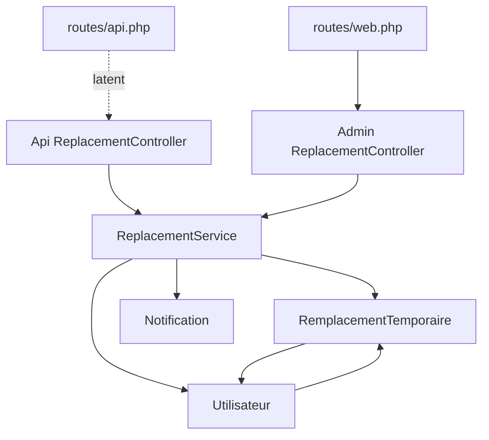

# Deep-Dive API/Back-end Bloc 4 - Flux Remplacements

**Generated:** 2026-02-13
**Scope:** Remplacements temporaires (controllers API/admin, service métier, modèles et exposition routes)
**Files Analyzed:** 8
**Lines of Code:** 2318
**Workflow Mode:** Exhaustive Deep-Dive

## Overview

Ce bloc couvre la chaîne complète des remplacements temporaires: création, consultation, terminaison, mise à jour des statuts utilisateurs et notifications. Le module est implémenté dans deux façades (`Api/ReplacementController` et `Admin/ReplacementController`) qui partagent le coeur métier `ReplacementService`.

**Purpose:** documenter précisément le flux remplacement pour réduire les régressions lors de modifications hiérarchiques (indisponibilité, support actif, supervision temporaire).

**Key Responsibilities:**
- Exposer les opérations de remplacement (listes, création, terminaison)
- Valider les contraintes métier (durée minimale, non-chevauchement titulaire/role)
- Synchroniser les statuts des utilisateurs (`Indisponible`, `Support_Actif`, `Actif`)
- Notifier titulaire/remplaçant/manager/équipe
- Maintenir un historique exploitable des remplacements

**Integration Summary:**
- Auth: `auth:sanctum` côté API, `auth + role:ADMIN` côté web admin
- Données: `remplacements_temporaires` (PGSQL), `utilisateurs` (MySQL), `notifications_utilisateurs` (MySQL)
- Couplage fort: logique remplacement utilisée indirectement par la logique d’évaluation via `Utilisateur::peutEvaluer(...)`

## API Surface and Exposure Status

### Routes API actives (`routes/api.php`)
- `GET /api/user`
- `GET /api/auth/check`

### Exposition Replacement API
- `app/Http/Controllers/Api/ReplacementController.php` est implémenté mais **aucune route active** ne le référence dans `routes/api.php`.
- Conséquence: surface API remplacement non exposée publiquement via le routeur API actuel.

### Exposition admin web (`routes/web.php`)
Sous `auth` + `role:ADMIN`, prefix `admin/remplacements`:
- `GET /admin/remplacements` -> `Admin\ReplacementController@index`
- `GET /admin/remplacements/create` -> `create`
- `POST /admin/remplacements` -> `store`
- `GET /admin/remplacements/{id}` -> `show`
- `GET /admin/remplacements/{id}/edit` -> `edit`
- `PUT /admin/remplacements/{id}` -> `update`
- `DELETE /admin/remplacements/{id}` -> `destroy` (route configurée mais méthode `destroy` absente dans le controller)

## Complete File Inventory

### `routes/api.php` (49 LOC)
- **Purpose:** surface API sanctum minimale.
- **Key details:** imports `EvaluationController`/`HierarchyController`, mais pas de bloc `replacement` routé.
- **Risks:** dérive entre code API implémenté et code effectivement accessible.

### `routes/web.php` (341 LOC)
- **Purpose:** surface web authentifiée/admin.
- **Key details:** routes admin replacement actives sous `admin/remplacements`.
- **Risks:** mapping `DELETE -> destroy` non aligné avec méthodes existantes (`terminer`).

### `app/Http/Controllers/Api/ReplacementController.php` (275 LOC)
- **Purpose:** façade JSON pour création/consultation/terminaison des remplacements.
- **Exports:** `getRemplacementsActifs`, `getRemplacementsAVenir`, `getHistoriqueRemplacements`, `getRemplacementsPourUtilisateur`, `getUtilisateurInfo`, `getSubordonnes`, `store`, `terminer`.
- **Dependencies:** `ReplacementService`, `Utilisateur`, `Validator`, `Auth`.
- **Key details:**
- Validation stricte des payloads entrée (dates, durée >= 30, matricules distincts).
- `store` délègue au service puis envoie les notifications selon `notifier_equipe`.
- `getSubordonnes` interroge via `id_manager` et enrichit les flags indisponibilité/remplacement.
- **Side effects:** écritures indirectes via service + envoi notifications.
- **Risks:** controller non routé; conventions de relations/champs hétérogènes (`role/region`, `id_manager` vs `manager_matricule`).

### `app/Http/Controllers/Admin/ReplacementController.php` (331 LOC)
- **Purpose:** façade admin web (Inertia/views) pour piloter les remplacements.
- **Exports:** `index`, `create`, `store`, `show`, `edit`, `update`, `terminer`, `getUtilisateurInfo`, `getSubordonnes`.
- **Dependencies:** `ReplacementService`, `RemplacementTemporaire`, `Utilisateur`, `Role`, `Region`.
- **Key details:**
- Utilise le même service métier que l’API.
- Restreint l’édition aux remplacements à venir.
- Termine un remplacement via `ReplacementService::terminerRemplacement`.
- **Risks:** route `destroy` déclarée mais absente; appel service avec argument supplémentaire (ambiguïté d’API interne).

### `app/Services/ReplacementService.php` (381 LOC)
- **Purpose:** coeur métier des remplacements.
- **Exports:** `creerRemplacement`, `terminerRemplacement`, `envoyerNotifications`, `getRemplacementsActifs`, `getRemplacementsAVenir`, `getHistoriqueRemplacements`, `getRemplacementsPourUtilisateur`, `estRemplacantPour`.
- **Dependencies:** `Utilisateur`, `RemplacementTemporaire`, `Notification`, `DB`, `Log`, `Carbon`.
- **Key details:**
- `creerRemplacement` ouvre transaction DB, vérifie conflits, crée remplacement, puis met à jour statuts titulaire/remplaçant.
- `terminerRemplacement` clôture remplacement et restaure statuts si aucun autre remplacement actif.
- `envoyerNotifications` notifie titulaire/remplaçant/manager et optionnellement équipe.
- **Side effects:** écritures multi-entités (PGSQL + MySQL), logs applicatifs.
- **Risks:** en cas d’erreur, retour `null/false` (fallback silencieux côté service), ce qui exige des garde-fous stricts côté controllers.

### `app/Models/RemplacementTemporaire.php` (176 LOC)
- **Purpose:** entité PGSQL des remplacements temporaires.
- **Key details:** cast dates/booleans + helpers `estActif`, `estTermine`, `estAVenir`, `terminer`.
- **Relations:** `titulaire`, `remplacant`, `createur`, `approbateur`, `evaluations`, `notifications`.

### `app/Models/Utilisateur.php` (497 LOC)
- **Purpose:** identité utilisateur + règles métier hiérarchiques/remplacement.
- **Key details replacement:**
- relations remplacements titulaire/remplaçant
- `estIndisponible`, `estRemplacantActif`, `estRemplace`, `remplacantActif`, `utilisateursRemplaces`
- impact direct dans `peutEvaluer(...)`.
- **Risks:** modèle très chargé; conventions legacy/matricule mélangées.

### `app/Models/Notification.php` (268 LOC)
- **Purpose:** notifications utilisateur (MySQL).
- **Key details:** création robuste avec fallback in-memory dans `Notification::creer(...)`.
- **Risks:** divergence de schéma potentielle avec certains appels legacy qui manipulent d’anciens noms de colonnes.

## Dependency Graph

### Entry Points (scope)
- `routes/api.php`
- `routes/web.php`

### Leaf Nodes (scope)
- `app/Models/Notification.php`

### Circular Dependencies
- Pas de cycle de fichier explicite; couplage métier bidirectionnel `Utilisateur <-> RemplacementTemporaire` via relations Eloquent.

## Data Flow Analysis

### 1) Création remplacement
1. Requête controller (`store`) valide payload.
2. `ReplacementService::creerRemplacement` vérifie existence titulaire/remplaçant.
3. Contrôle absence de remplacement actif conflictuel pour même titulaire/rôle.
4. Création `remplacements_temporaires` + bascule statut titulaire/remplaçant.
5. Commit transaction.
6. Envoi notifications (titulaire, remplaçant, manager, équipe optionnelle).

### 2) Terminaison remplacement
1. Requête controller (`terminer`) valide date fin.
2. `ReplacementService::terminerRemplacement` charge remplacement.
3. Marque `est_actif=false`, renseigne `date_fin_effective`.
4. Restaure statut titulaire/remplaçant si plus aucun remplacement actif concurrent.
5. Commit transaction + retour succès.

### 3) Consultation des listes
1. Controllers appellent service (`actifs`, `à venir`, `historique`, `par utilisateur`).
2. Service applique filtres temporels et état `est_actif`.
3. Eager loading `titulaire/remplacant`.
4. Retour JSON/Inertia.

## Integration Points

### APIs exposed
- Web admin replacement routes actives (`admin/remplacements/*`).
- API replacement non exposée dans le routeur API actuel.

### Internal consumers
- `Admin\ReplacementController` (flow principal visible)
- Potentiels consommateurs API internes si routage futur de `Api\ReplacementController`

### Database access
- `remplacements_temporaires` via modèle PGSQL.
- `utilisateurs` et notifications via MySQL.

### Auth and authorization
- API: middleware `auth:sanctum` au constructeur.
- Web: middleware route-level `auth` + `role:ADMIN`.

## Related Code References (outside scope)

- `app/Http/Controllers/RemplacementsController.php`: autre implémentation admin replacement avec conventions différentes.
- `app/Http/Controllers/Api/UtilisateurController.php`: endpoints utilisateurs/subordonnés avec logique proche.
- `app/Services/HierarchyService.php`: supervision hiérarchique qui influence le contexte remplacement.

## Reuse Opportunities

- Centraliser un DTO/normaliseur des identifiants (`matricule`, `id_utilisateur`, `manager_matricule`) pour éviter les divergences.
- Réutiliser un service de notifications unique (`Notification::creer`) au lieu de payloads legacy hétérogènes.
- Unifier les deux façades replacement (API + admin) autour d’une même convention de réponse/erreurs.

## Contributor Checklist

- **Risks & gotchas:**
- Controller API replacement implémenté mais non routé.
- Route `DELETE admin/remplacements/{id}` pointe vers `destroy` non implémenté.
- Mélange des conventions de relations/champs (`role/region` vs `roleModel/regionEntity`, `id_manager` vs `manager_matricule`).
- **Pre-change verification steps:**
- Vérifier table de routage effective (`php artisan route:list | rg remplacements`).
- Tester création + terminaison replacement avec cas concurrent (titulaire/remplaçant multiples).
- Vérifier persistance notifications et compatibilité schéma.
- **Suggested tests before PR:**
- Tests feature web admin replacement (CRUD + terminaison).
- Tests unitaires `ReplacementService` (transactions, restauration des statuts).
- Tests d’intégration notifications (titulaire/remplaçant/manager/équipe).

## Modification Guidance

### To add new replacement feature
- Ajouter la règle métier dans `ReplacementService` en premier.
- Brancher ensuite dans controller cible (API ou admin).
- Ajouter tests sur statuts utilisateur et collisions de périodes.

### To modify existing behavior
- Harmoniser d’abord la convention d’identifiants et de relations Eloquent.
- Conserver la symétrie `creerRemplacement` / `terminerRemplacement` sur les transitions de statut.

### To deprecate/remove
- Retirer route, controller et appel service ensemble pour éviter des endpoints fantômes.
- Prévoir migration des consommateurs vers la façade conservée.

### Testing checklist
- [ ] Création remplacement valide avec durée >= 30
- [ ] Refus de conflit titulaire/role actif
- [ ] Terminaison restaure correctement les statuts
- [ ] Notifications envoyées selon le périmètre choisi
- [ ] Routage et méthodes controller alignés

---
_Generated by document-project workflow (deep-dive progressive mode)_
_Base Documentation: docs/index.md_
_Scan Date: 2026-02-13_
_Analysis Mode: Exhaustive_
