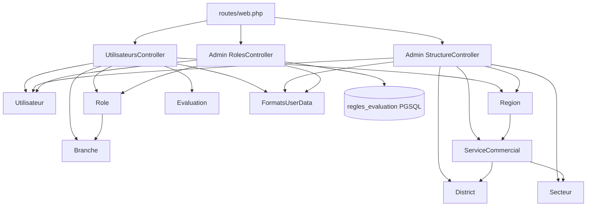

# Deep-Dive API/Back-end Bloc 5 - Admin Hiérarchie (Utilisateurs / Structure / Rôles)

**Generated:** 2026-02-13
**Scope:** Back-office hiérarchique admin (gestion utilisateurs, structure organisationnelle, rôles/permissions)
**Files Analyzed:** 13
**Lines of Code:** 3805
**Workflow Mode:** Exhaustive Deep-Dive

## Overview

Ce bloc couvre le socle d’administration hiérarchique côté Laravel/Inertia: la gestion des utilisateurs (`UtilisateursController`), la structure organisationnelle (`StructureController`) et la gouvernance des rôles/permissions (`RolesController`). L’ensemble est routé sous `/admin/*` avec middleware `role:ADMIN`.

**Purpose:** fournir une cartographie opérationnelle pour faire évoluer les écrans d’admin hiérarchique sans casser la cohérence rôle/région/branche.

**Key Responsibilities:**
- CRUD utilisateurs + visualisation hiérarchique + analyse de gaps
- CRUD structure (régions/services/districts/secteurs) avec vérification de dépendances
- CRUD rôles + matrice permissions + gestion des règles d’évaluation
- Préparer les données Inertia pour le front admin

**Integration Summary:**
- Front: pages Inertia `Admin/Utilisateurs/*`, `Admin/structure/*`, `Admin/Roles/*`
- Data: MySQL (`utilisateurs`, `roles`, `regions`, `services_commerciaux`, `districts`, `secteurs`) + PGSQL (`regles_evaluation`)
- Couplage métier: logique d’évaluation (gaps, règles) et hiérarchie manager/subordonnés

## Route Surface (Admin)

Sous `routes/web.php`, groupe `auth + role:ADMIN`, prefix `admin`:

### Utilisateurs
- `GET /admin/utilisateurs` -> `UtilisateursController@index`
- `GET /admin/utilisateurs/gaps` -> `gaps`
- `GET /admin/utilisateurs/create` -> `create`
- `POST /admin/utilisateurs` -> `store`
- `GET /admin/utilisateurs/{matricule}` -> `show`
- `GET /admin/utilisateurs/{matricule}/edit` -> `edit`
- `PUT /admin/utilisateurs/{matricule}` -> `update`

### Structure
- `GET /admin/structure` -> `StructureController@overview`
- `GET/POST/PUT/DELETE /admin/structure/regions*`
- `GET/POST/PUT/DELETE /admin/structure/services*`
- `GET/POST/PUT/DELETE /admin/structure/districts*`
- `GET/POST/PUT/DELETE /admin/structure/secteurs*`

### Rôles
- `GET /admin/roles` -> `RolesController@index`
- `GET /admin/roles/permissions` -> `permissions`
- `POST /admin/roles/permissions/update` -> `updatePermissions`
- CRUD rôle (`create/store/show/edit/update/destroy`)
- règles évaluation (`createRule/storeRule/updateRule`)

## Complete File Inventory

### `routes/web.php` (341 LOC)
- **Purpose:** routing principal auth/admin.
- **Key details:** concentre la quasi-totalité des entrypoints admin hiérarchie.
- **Risks:** forte densité de routes hétérogènes dans un seul fichier.

### `app/Http/Controllers/UtilisateursController.php` (722 LOC)
- **Purpose:** administration des utilisateurs (liste hiérarchique, CRUD, gaps).
- **Exports:** `index`, `show`, `create`, `store`, `edit`, `update`, `gaps`.
- **Dependencies:** `Utilisateur`, `Region`, `Branche`, `Role`, `Evaluation`, `EvaluationService`, `FormatsUserData`.
- **Key details:**
- Construit une hiérarchie arbre via `manager_matricule`.
- Prépare des DTOs front riches (stats, filtres, détails user).
- Inclut plusieurs helpers analytiques (gaps, calculs de notes).
- **Risks:** contrôleur monolithique + logique métier/présentation mêlée; cohérence de statuts (`actif/inactif` vs `Actif/Indisponible`) fragile.

### `app/Http/Controllers/Admin/StructureController.php` (666 LOC)
- **Purpose:** gestion complète de l’arborescence organisationnelle.
- **Exports:** `overview`, `regions/storeRegion/updateRegion/destroyRegion`, `services/storeService/updateService/destroyService`, `districts/storeDistrict/updateDistrict/destroyDistrict`, `secteurs/storeSecteur/updateSecteur/destroySecteur`.
- **Dependencies:** `Region`, `ServiceCommercial`, `District`, `Secteur`, `Utilisateur`, `FormatsUserData`.
- **Key details:**
- Construit un tree multi-niveaux avec compteurs d’effectifs.
- Recherche les leaders structurels par rôle (`DR`, `CSC`, `CDV`, `CDS`).
- Vérifie les dépendances avant suppression d’entités structurelles.
- **Risks:** logique de mapping front très volumineuse dans le controller.

### `app/Http/Controllers/Admin/RolesController.php` (572 LOC)
- **Purpose:** gestion des rôles et de la matrice de permissions SABC.
- **Exports:** `index`, `permissions`, `updatePermissions`, `create/store/show/edit/update/destroy`, `createRule/storeRule/updateRule`.
- **Dependencies:** `Role`, `Utilisateur`, `FormatsUserData`, accès direct PGSQL via `DB`.
- **Key details:**
- Administre les permissions de rôle et les règles d’évaluation actives.
- Gère compatibilité schéma PGSQL (colonnes optionnelles) via introspection `Schema`.
- **Risks:** pont MySQL/PGSQL dans un seul controller; vocabulaire de champs parfois hétérogène (`peut_cross_branch` vs `peut_evaluer_cross_branch`).

### `app/Models/Role.php` (148 LOC)
- **Purpose:** matrice de capacités d’évaluation et niveaux hiérarchiques.
- **Key details:** méthode `peutEvaluer(...)` porte des règles critiques (RTM/SRMO, pairs, cross-branch).

### `app/Models/Region.php` (86 LOC)
- **Purpose:** région + typologie tanière/non-tanière.
- **Key details:** base des agrégations structurelles et permissions régionales.

### `app/Models/ServiceCommercial.php` (83 LOC)
### `app/Models/District.php` (83 LOC)
### `app/Models/Secteur.php` (84 LOC)
- **Purpose:** niveaux intermédiaires/finaux de la structure commerciale.
- **Key details:** relations de navigation nécessaires à l’arbre admin et aux contrôles de dépendances.

### `app/Models/Branche.php` (67 LOC)
- **Purpose:** segmentation de branche (commercial/marketing) utilisée en gestion utilisateurs/rôles.

### `app/Models/Utilisateur.php` (497 LOC)
- **Purpose:** identité auth + règles hiérarchiques et d’évaluation.
- **Key details:** clé auth `matricule`, relation manager/subordonnés, helpers remplacement et évaluation.
- **Risks:** modèle central surchargé.

### `app/Traits/FormatsUserData.php` (197 LOC)
- **Purpose:** normalisation des données utilisateur/permissions pour les pages admin.
- **Key details:** mapping rôle -> libellé + permissions UI.

### `app/Models/Evaluation.php` (259 LOC)
- **Purpose:** entité d’évaluation utilisée par les helpers d’analyse de gaps.
- **Risks:** conventions legacy `id_*` différentes du flux matricule moderne.

## Dependency Graph

### Entry Points (scope)
- `routes/web.php`

### Leaf Nodes (scope)
- `app/Models/Branche.php`
- `app/Traits/FormatsUserData.php`

### Circular Dependencies
- Pas de cycle de fichier explicite; couplage fonctionnel fort via `Utilisateur` (pivot commun).

## Data Flow Analysis

### 1) Gestion utilisateurs (CRUD)
1. Admin ouvre `/admin/utilisateurs`.
2. `UtilisateursController@index` charge utilisateurs + relations + données de référence (régions/roles/branches).
3. Construction arbre hiérarchique via `construireHierarchie`.
4. Rendu Inertia avec stats + dataset.
5. `store/update` appliquent validation et persistences sur `utilisateurs`.

### 2) Vue structure organisationnelle
1. Admin ouvre `/admin/structure`.
2. `StructureController@overview` charge régions et niveaux enfants avec compteurs.
3. Résolution des leaders structurels (`findStructureLead`).
4. Construction d’un tree normalisé pour le front.
5. Rendu Inertia avec statistiques globales.

### 3) Gouvernance rôles/permissions
1. Admin ouvre `/admin/roles` ou `/admin/roles/permissions`.
2. `RolesController` agrège rôles + permissions + règles d’évaluation actives (PGSQL).
3. `updatePermissions` met à jour table `regles_evaluation` puis matrice rôles MySQL.
4. Retour UI avec message succès/erreur.

## Integration Points

### APIs exposed
- Surface web admin complète sous `/admin/{utilisateurs|structure|roles}` (session web).

### Internal APIs consumed
- Utilisation de services Laravel DB multi-connexions (`mysql`, `pgsql`) dans `RolesController`.
- Réutilisation du trait `FormatsUserData` pour homogénéiser payload UI.

### Database access
- MySQL: structure organisationnelle + utilisateurs + rôles.
- PGSQL: `regles_evaluation` (lecture/écriture dans controller rôles).

### Auth and authorization
- Contrôle principal via middleware route-level `role:ADMIN`.
- Contrôle défensif supplémentaire dans `UtilisateursController::assertAdmin`.

## Related Code References (outside scope)

- `app/Services/HierarchyService.php`: règles de supervision/assignation manager côté API.
- `app/Http/Controllers/Api/HierarchyController.php`: endpoints hiérarchiques API (non routés explicitement).
- `app/Http/Controllers/Api/ReplacementController.php`: impact replacement sur supervision et statuts.

## Reuse Opportunities

- Extraire un service dédié à la construction d’arbres hiérarchiques pour éviter la duplication (`UtilisateursController` vs `StructureController`).
- Centraliser le vocabulaire des statuts utilisateur (`Actif/Indisponible` vs `actif/inactif`).
- Introduire un mapper unique des champs de permissions rôles pour éviter les divergences de naming entre controller, modèle et payload front.

## Contributor Checklist

- **Risks & gotchas:**
- Contrôleurs très volumineux avec logique métier embarquée.
- Conventions de champs permissions non homogènes (`peut_cross_branch` / `peut_evaluer_cross_branch`).
- Coexistence de conventions identifiants legacy et matricule dans les modèles d’évaluation.
- **Pre-change verification steps:**
- Vérifier `route:list` sur tout le namespace admin.
- Vérifier rendu Inertia des pages `Admin/Utilisateurs`, `Admin/structure`, `Admin/Roles`.
- Vérifier update permissions sur base PGSQL (colonnes optionnelles).
- **Suggested tests before PR:**
- Tests feature CRUD utilisateurs (création/édition + sécurité admin).
- Tests feature structure (suppression bloquée si dépendances).
- Tests feature rôles/permissions (mise à jour matrice + règles).
- Tests de non-régression sur mapping statuts et permissions affichées.

## Modification Guidance

### To add new admin hierarchy feature
- Introduire d’abord un service métier (hors controller) pour la nouvelle règle.
- Exposer ensuite endpoint/controller avec payload normalisé.
- Ajouter test feature front-to-back (Inertia + DB).

### To modify existing behavior
- Vérifier impacts croisés sur `UtilisateursController`, `StructureController`, `RolesController`.
- Harmoniser les noms de champs à la frontière API/UI avant la modification fonctionnelle.

### To deprecate/remove
- Déprécier route + méthode controller + vue Inertia dans le même incrément.
- Conserver une compatibilité temporaire sur les clés de payload front si nécessaire.

### Testing checklist
- [ ] CRUD utilisateurs admin opérationnel
- [ ] Arbre structure cohérent (région/service/district/secteur)
- [ ] Blocage suppression avec dépendances effectif
- [ ] Mise à jour permissions/règles persistée (MySQL + PGSQL)
- [ ] Mapping statuts/permissions cohérent dans les réponses UI

---
_Generated by document-project workflow (deep-dive progressive mode)_
_Base Documentation: docs/index.md_
_Scan Date: 2026-02-13_
_Analysis Mode: Exhaustive_
