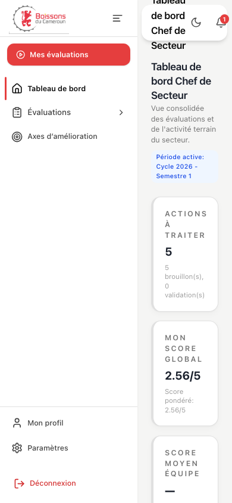
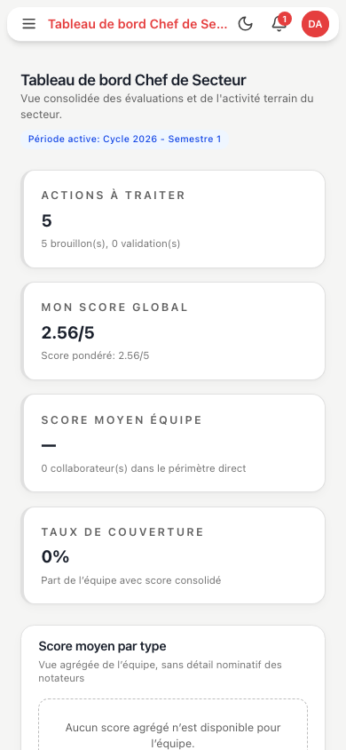
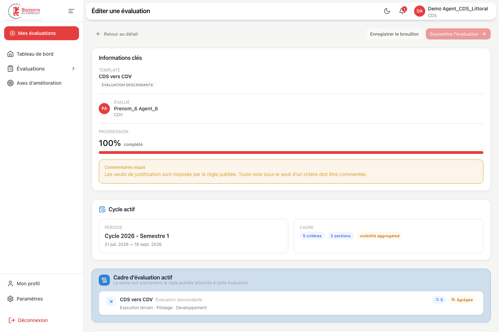
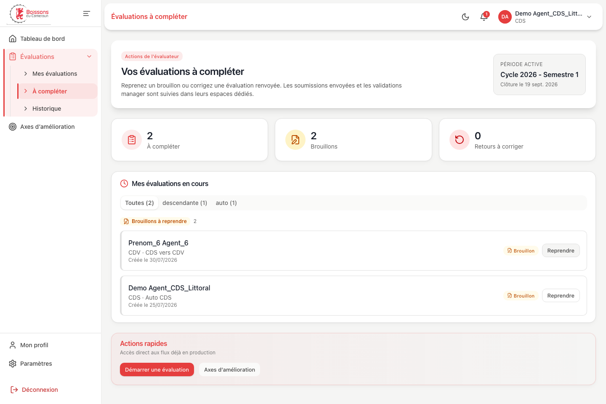
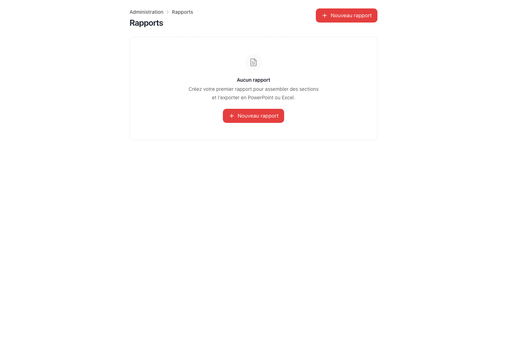
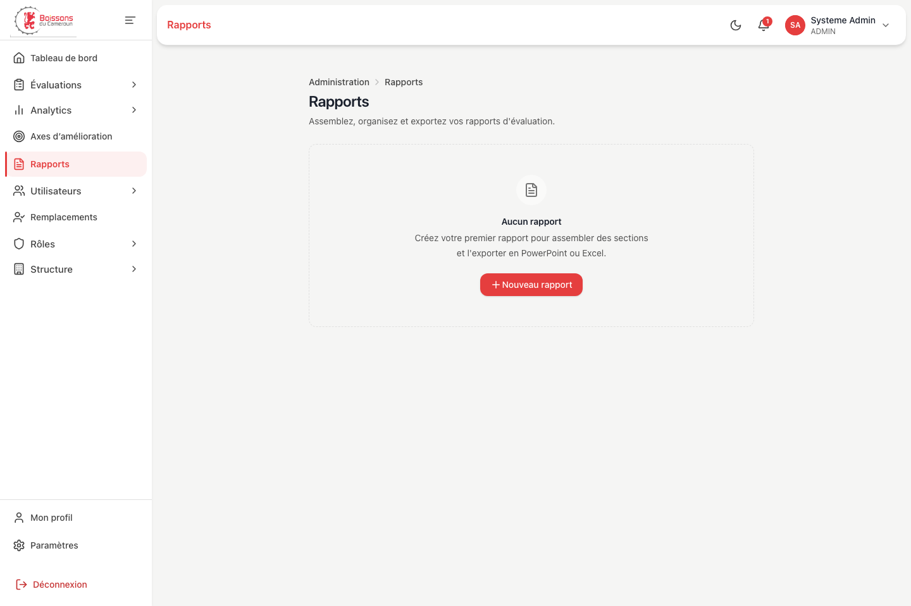
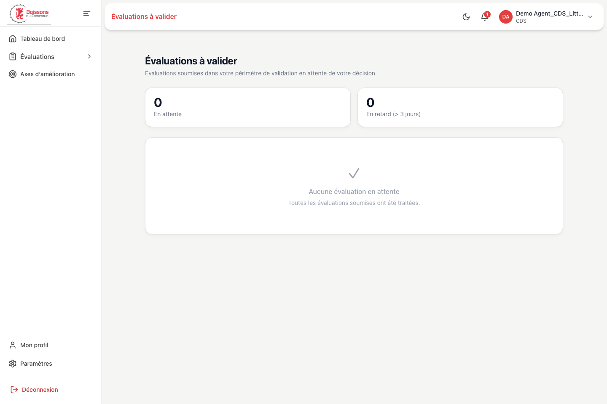
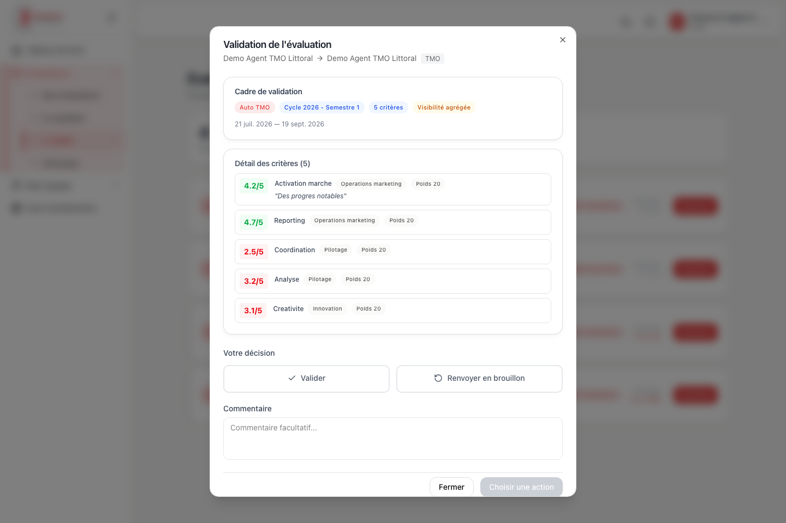

# Audit UX/UI et parcours utilisateurs — 6 août 2026

## Verdict

Les parcours principaux sont maintenant cohérents et vérifiés sur les 11 rôles de démonstration, en desktop et en mobile. Les corrections portent autant sur la lisibilité visuelle que sur les impasses fonctionnelles : une action affichée correspond désormais à une action réellement disponible, les prérequis manquants sont expliqués et les fonctions inachevées ne sont plus présentées comme opérationnelles.

Le rejeu final couvre 17 scénarios Playwright et passe intégralement. Il vérifie notamment la présence d'un titre principal, l'absence de débordement horizontal, l'absence d'identifiants HTML dupliqués, les droits de navigation, les validations ciblées, les formulaires et le tiroir mobile.

## Périmètre couvert

| Parcours | Utilisateurs concernés | État final |
| --- | --- | --- |
| Connexion et récupération de compte | Tous les rôles | Sain |
| Tableau de bord individuel | TMO, CDV, AS, SS, SRMO et rôles sans équipe directe | Sain |
| Tableau de bord manager et équipe | RTM, CDS et managers de proximité selon leurs capacités | Sain |
| Pilotage régional | DR, CDTT | Sain |
| Création, brouillon, soumission et retour manager | Évaluateurs | Sain |
| File de validation et décision | Managers/directeurs ayant une file réelle | Sain |
| Axes d'amélioration et recommandations | Individus, managers, admin | Sain ; génération admin rendue accessible |
| Administration utilisateurs, structure, règles, périodes, rapports | ADMIN | Sain, avec garde-fous de prérequis |
| Navigation mobile | Tous les rôles | Sain, sans débordement horizontal |

## Corrections livrées

### Navigation et hiérarchie

- Suppression des CTA dupliqués entre l'en-tête, le contenu, la barre latérale et le menu du profil.
- Barre latérale responsive remplacée sur mobile par un tiroir avec fond bloquant, fermeture explicite et gestion du focus.
- Navigation calculée à partir du périmètre réel : un rôle sans équipe ne voit plus « Vue équipe » ou « Évaluations équipe ».
- La file « À valider » est visible dès qu'une validation réelle existe, y compris pour un rôle sans subordonné direct.
- Les validations présentées sur les dashboards ouvrent directement l'évaluation concernée.
- Les anciennes URLs de « Permissions » et d'assignations de templates redirigent vers les surfaces réellement opérationnelles.

### Évaluations

- Séparation nette entre « À compléter » pour l'évaluateur et « À valider » pour le manager.
- Progression calculée à partir des critères effectivement notés ; la soumission reste bloquée tant que le formulaire est incomplet.
- Les notes commencent à l'état non renseigné et les justifications obligatoires sont annoncées clairement.
- Les évaluations rejetées restent récupérées au-delà de la première page d'historique.
- La page « Évaluations d'équipe » interprète correctement les files `en_attente` et `a_valider`, les déduplique et affiche l'étape/action exacte.
- Retour du détail vers le vrai point d'entrée du parcours, avec un repli cohérent en accès direct.
- Création de brouillon impossible tant que la règle n'est pas chargée, active et dotée de critères.
- Le CTA de démarrage disparaît lorsqu'il n'existe ni période, ni cible, ni règle applicable.

### Administration

- Les créations impossibles sont remplacées par un état explicatif et un lien vers le prérequis : région avant service, service avant district/secteur, rôle et région avant utilisateur, période/règle/cible avant évaluation, deux utilisateurs avant remplacement.
- « Permissions », écran redondant et non raccordé, n'est plus exposé.
- Les assignations rôle/période des templates sont masquées tant qu'elles ne déterminent pas la règle utilisée à la création.
- Les cartes d'anomalies n'imitent plus un lien lorsqu'elles ne sont pas cliquables.
- La génération des recommandations est désormais disponible depuis les plans d'amélioration admin.
- Le rapport admin utilise le shell commun et ne présente plus deux CTA « Nouveau rapport ».

### Accessibilité et résilience

- Titres `h1` présents sur les pages authentifiées, sans répétition artificielle dans l'en-tête utilitaire.
- Champs, listes déroulantes, erreurs et textes d'aide reliés avec `id`, `aria-describedby`, `aria-invalid` et `aria-errormessage`.
- Boutons d'icône, comptes de démonstration, filtres et décisions de validation nommés explicitement.
- Cartes de validation remplacées par une action clavier explicite ; aucune carte entière n'est un faux bouton.
- Noms techniques et valeurs internes humanisés (`Prenom_8` devient `Prenom 8`, `aggregated` devient « agrégée »).
- Brouillons hors ligne restaurés avant synchronisation et isolés par matricule sur un navigateur partagé.
- Correction du rate limiting NestJS : les seuils spécialisés n'abaissent plus par erreur le plafond de toutes les routes. Les définitions nommées s'appliquent toutes lorsqu'elles sont enregistrées globalement, conformément à la [documentation officielle de `@nestjs/throttler`](https://github.com/nestjs/throttler#multiple-throttler-definitions).

## Preuves visuelles

### Mobile : contenu inutilisable puis pleine largeur

Avant :

Après :

### Formulaire : faux 100 % puis progression réelle

Avant :

Après :

### Rapports : page isolée et CTA dupliqué puis parcours intégré

Avant :

Après :

### Validation manager réellement actionnable

Toutes les captures avant/après sont conservées dans [`artifacts/ux-audit`](../../artifacts/ux-audit/).

## Vérifications exécutées

- Playwright : **17/17 scénarios**.
- Vitest web : **98/98 tests**, 13 fichiers.
- TypeScript web : réussi.
- Build web de production : réussi ; avertissement non bloquant sur un chunk analytics supérieur à 500 kB.
- Tests unitaires ciblés API du limiteur : **5/5**.
- Jest API complet : **543/543 tests**, 51 suites.
- TypeScript API : réussi.
- Build API : réussi.
- ESLint ciblé sur les fichiers API modifiés : réussi. Le lint global de l'API reste non passant sur le code historique (**2 158 erreurs**, principalement les règles `no-unsafe-*`) ; ces fichiers ont été laissés inchangés.
- Vérification des espaces et conflits de patch avec `git diff --check` : réussie.

## Limites et décisions encore nécessaires

- L'assignation template/rôle/période existe dans le stockage mais ne pilote pas encore la règle utilisée à la création. Elle est volontairement masquée jusqu'au choix d'une architecture métier unique entre templates et règles.
- La page équipe expose honnêtement les actions en cours ; un historique d'équipe exhaustif demanderait un endpoint dédié.
- Le composant `Slider` historique, non utilisé par les routes actives, reste à remplacer ou rendre accessible avant toute réactivation.
- Le fallback historique de `normalizeRole` reste conservé pour compatibilité. Une revue sécurité distincte devra décider s'il faut refuser strictement tout rôle inconnu et généraliser les gardes de route.
- Le chunk analytics principal mérite un chantier de découpage dynamique, sans impact bloquant sur la correction des parcours.
- L'audit s'appuie sur des données de démonstration réalistes et des contrôles automatisés ; il ne remplace pas une session de test avec des utilisateurs métier SABC ni un audit WCAG certifiant.
